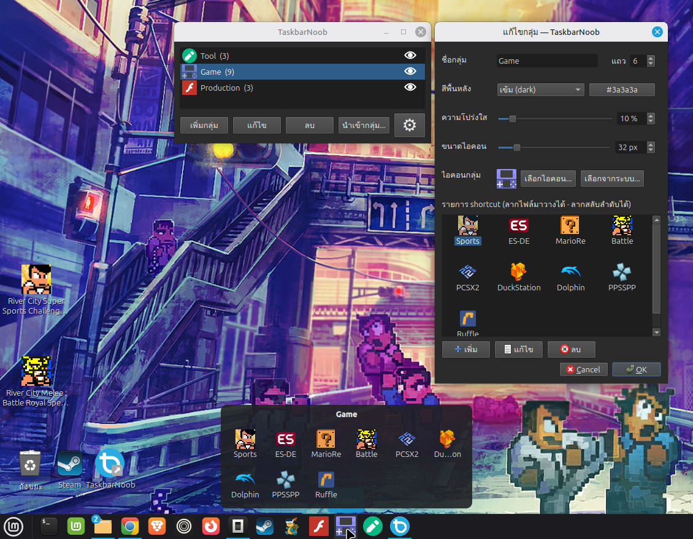
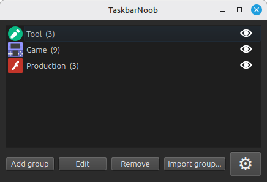
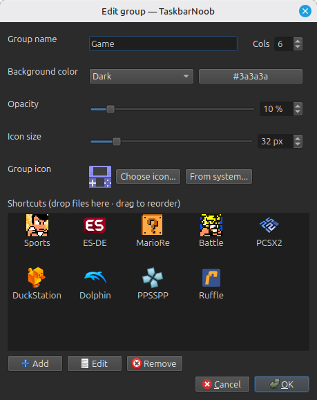

# TaskbarNoob

[](https://github.com/Neafong/TaskbarNoob/releases/latest)
[](https://github.com/Neafong/TaskbarNoob/releases)
[](LICENSE)
[-green.svg?style=flat-square)](#)
[-yellow.svg?style=flat-square)](#)
[](https://github.com/Neafong/TaskbarNoob/actions)

> **รวบรวมทางลัด เรื่อง shortcut เราช่วยจัด** · *Gather your shortcuts, we do the rest.*

จัดกลุ่ม shortcut ของคุณให้เป็นระเบียบ แล้วกดครั้งเดียวเปิดทั้งกลุ่มได้เลย
ทำสำหรับ **Linux Mint (Cinnamon)** เป็นหลัก · **Windows** = portable alpha · **macOS** = มีโค้ดแต่ยังไม่ทดสอบ

ชื่อ "Noob" ของเราไม่ได้หมายถึงแย่ — แต่หมายถึง **น้ำไม่เต็มแก้ว** ถ่อมตน ไม่มีอีโก้
เรียนรู้และเก่งขึ้นได้เรื่อย ๆ · แจกฟรี ทำด้วยใจ ❤️

---

## ตัวอย่างหน้าจอ / Screenshots

**ภาพรวมหน้าจอ / Overview**



| หน้าหลัก / Main window | แก้ไขกลุ่ม / Edit group |
| :---: | :---: |
|  |  |

## ฟีเจอร์เด่น / Features

- 🗂️ จัดกลุ่ม shortcut เป็นการ์ด แต่ละกลุ่มมี grid ของไอคอน (ลากจัดลำดับได้)
- 📌 ปักหมุดกลุ่มลง **panel (Cinnamon Grouped Window List)** กดแล้วเปิด flyout
- ⌨️ ตั้ง **ปุ่มลัด (hotkey)** เปิดกลุ่มได้ทันที
- 🎨 ธีม auto / light / dark · ปรับความโปร่งใสและขนาดไอคอน
- 💾 **Portable** — config อยู่ในโฟลเดอร์แอป (`config/`)
- 🌐 ภาษา **ไทย / English** + เพิ่มภาษาใหม่เองได้ผ่านไฟล์ JSON
- 📦 สำรอง/กู้คืน config ทั้งชุดเป็นไฟล์ `.zip`

> ฟีเจอร์ hotkey และการปักหมุด panel รองรับ **Cinnamon เท่านั้น**

## แพลตฟอร์มที่รองรับ / Supported platforms

| ระบบ | สถานะ |
| :--- | :--- |
| **Linux Mint (Cinnamon)** | ✅ รองรับหลัก — ทดสอบแล้ว |
| **Windows** | 🟡 portable **alpha** — โค้ดพร้อม กำลังทดสอบบนเครื่องจริง |
| **macOS** | ⚪ **ยังไม่รับประกัน** — มีโค้ดรองรับ (`core/macos.py`) แต่ยังไม่ทดสอบ |

> **หมายเหตุ macOS:** เรามีโค้ดรองรับ macOS เขียนไว้แล้ว (launcher `.command` + ปัก Dock แบบ best-effort)
> แต่ยังไม่เคยรันบนเครื่องจริง (ทีมไม่มีเครื่อง Mac) จึง **ไม่เปิดให้ดาวน์โหลด build สำหรับ macOS**
> หากใครสะดวก fork ไป build/ทดสอบเอง ยินดีรับ PR ค่ะ

## ดาวน์โหลด & ติดตั้ง / Download & Install

[](https://github.com/Neafong/TaskbarNoob/releases/latest)

เลือกจากหน้า **Releases** ของ repo:

**AppImage** (ไม่ต้องติดตั้ง)
```bash
chmod +x TaskbarNoob-x86_64.AppImage
./TaskbarNoob-x86_64.AppImage
```

**`.deb`** (Debian/Ubuntu/Mint)
```bash
sudo apt install ./taskbargroups_<version>_amd64.deb
```

## รันจากซอร์ส / Run from source

```bash
python3 -m venv .venv
.venv/bin/pip install -r requirements.txt
.venv/bin/python -m taskbargroups
```

CLI:
```bash
.venv/bin/python -m taskbargroups --list              # แสดงรายชื่อกลุ่ม
.venv/bin/python -m taskbargroups --open "<GroupDir>" # เปิด flyout ของกลุ่ม
```

## Build แพ็กเกจ / Build packages

```bash
bash packaging/build_appimage.sh   # -> dist/TaskbarNoob-x86_64.AppImage
bash packaging/build_deb.sh        # -> dist/taskbargroups_<ver>_amd64.deb
```

## ทดสอบ / Tests

```bash
.venv/bin/python tests/run.py      # 307 tests
```

## การเพิ่มภาษา / Adding a language

1. Settings → **ส่งออกภาษา** เพื่อได้ไฟล์ JSON ต้นแบบ
2. แปลค่า (value) เป็นภาษาของคุณ · เปิดดู asset ตัวอย่างได้ที่ [`packaging/lang/ja.json`](packaging/lang/ja.json) (ญี่ปุ่น)
3. Settings → **นำเข้าภาษา** เลือกไฟล์ที่แปล → เลือกใช้จากช่องภาษาได้เลย

## โครงสร้างโปรเจกต์ (ย่อ) / Project layout

```
taskbargroups/
├── core/   ตรรกะล้วน (ไม่พึ่ง Qt) — storage · icons · launcher · hotkeys · archive · i18n
└── gui/    ส่วน Qt/PySide6 — main_window · group_editor · flyout · settings_dialog …
packaging/  build scripts · assets (โลโก้) · lang (asset ภาษา) · appimage/
tests/      unittest ชุดทดสอบ
docs/       เอกสารออกแบบ + worklog
```

## เครดิต & สนับสนุน / Credits & Support

สร้างโดย **Noob & Pickle** — ไอเดีย/ดีไซน์: นู๊บ · โค้ด: น้องพริก

ถ้าชอบและอยากสนับสนุน ☕ → [ko-fi.com/neafong](https://ko-fi.com/neafong)

## Roadmap

- [x] **Linux Mint (Cinnamon)** — จัดกลุ่ม shortcut · ปักหมุด panel · hotkey · ไทย/อังกฤษ · สำรอง/กู้คืน config
- [~] **Windows** — portable alpha (โค้ดพร้อม · กำลังทดสอบบนเครื่องจริง)
- [~] **macOS** — มีโค้ดรองรับ แต่ยังไม่ทดสอบ (รอเครื่อง Mac)
- [ ] ฟีเจอร์เพิ่มเติมตามฟีดแบ็กผู้ใช้

## License

**GNU General Public License v3.0 or later (GPL-3.0-or-later)**

Copyright (C) 2026 Noob & Pickle

โปรแกรมนี้เป็นซอฟต์แวร์เสรี — คุณใช้/ศึกษา/แก้ไข/แจกจ่ายได้ ภายใต้เงื่อนไข GPL
โดยเฉพาะ **ถ้านำไปแจกจ่ายหรือต่อยอด ต้องเปิดซอร์สโค้ดให้ผู้อื่นด้วยในเงื่อนไขเดียวกัน**
ดูข้อความสัญญาอบับเต็มที่ไฟล์ [LICENSE](LICENSE) · `SPDX-License-Identifier: GPL-3.0-or-later`

<sub>หมายเหตุ: ไลบรารี Qt/PySide6 ที่ใช้เป็นลิขสิทธิ์แยกต่างหาก (LGPLv3) — ไม่ได้อยู่ภายใต้ GPL ของโปรเจกต์นี้</sub>


---

<sub>ชื่อที่แสดงบนหน้าจอคือ **TaskbarNoob** · ตัวรหัสแอปยังใช้ `taskbargroups` เพื่อไม่ให้ config/การปักหมุดเดิมพัง</sub>
