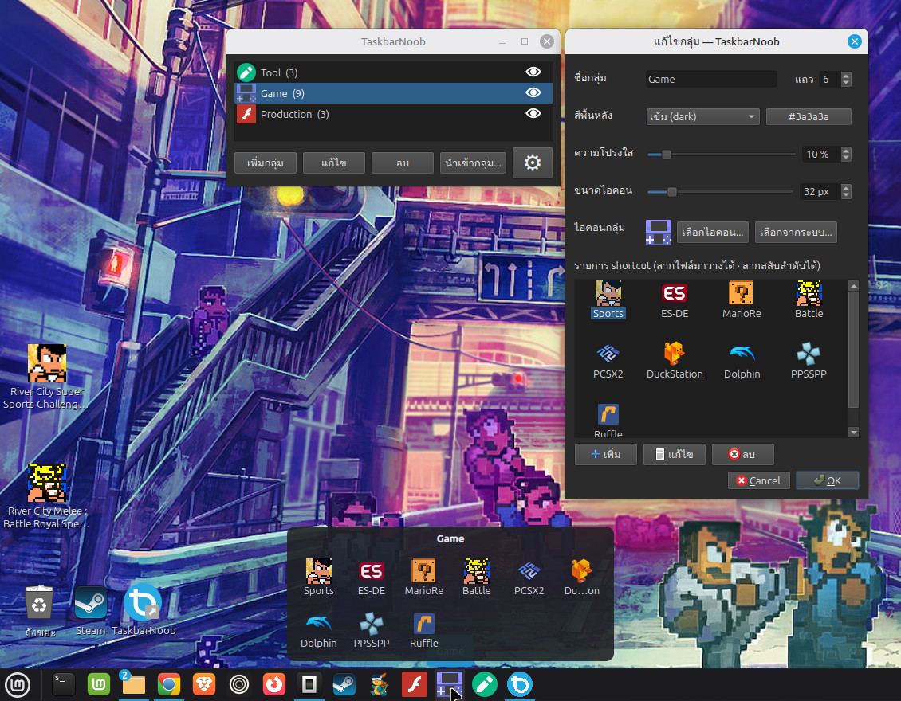
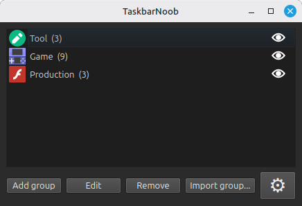
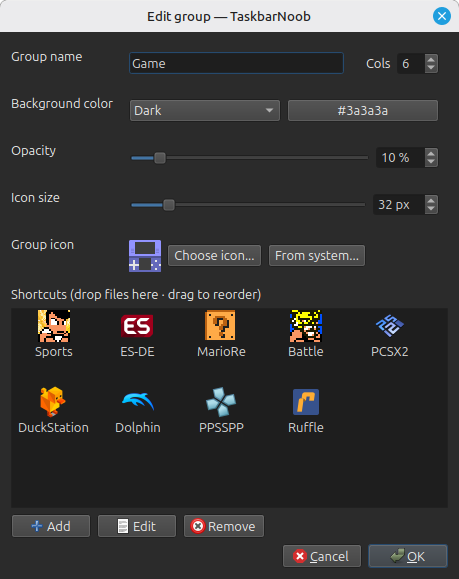

# TaskbarNoob

<p align="left">
  <strong>🌐 English</strong> · <a href="README.th.md">🇹🇭 ภาษาไทย</a>
</p>

[](https://github.com/Neafong/TaskbarNoob/releases/latest)
[](https://github.com/Neafong/TaskbarNoob/releases)
[](LICENSE)
[-green.svg?style=flat-square)](#)
[-blue.svg?style=flat-square)](#)
[](#)
[](https://github.com/Neafong/TaskbarNoob/actions)

> **Gather your shortcuts, we do the rest.** · *รวบรวมทางลัด เรื่อง shortcut เราช่วยจัด*

Organize your shortcuts into clean groups and launch them from a single taskbar icon — inspired by [Taskbar Groups](https://github.com/tjackenpacken/taskbar-groups).
Built for **Linux Mint (Cinnamon)** and **Windows 11 (Portable)** · Free & Open Source.

Why **"Noob"**? To us, "Noob" doesn't mean bad — it means staying humble, keeping an open mind, and always leveling up. Free for everyone, crafted with care ❤️

---

## Screenshots

**Overview**



| Main Window | Group Editor |
| :---: | :---: |
|  |  |

## Features

- 🗂️ **Shortcut groups** — Organize apps into cards with drag-and-drop icon grids and optional per-group icon labels
- 📱 **One-click "From apps..." picker** — Add installed apps directly from Linux `.desktop` / Flatpak / Snap or Windows Start Menu / MSIX
- 🖼️ **Smart icon extraction** — Automatically pulls crisp icons from **AppImage**, Electron/portable `.asar` bundles, **Steam** (`steam://rungameid/`), Flatpak/Snap, and Windows **MSIX**, plus a categorized system icon picker
- 📌 **Taskbar & Panel integration** — Pin groups directly to the **Cinnamon panel** (with flyouts anchored dead-center above the pinned icon) or generate per-group **AUMID** `.lnk` shortcuts on **Windows 11**
- ⌨️ **Global hotkeys & Focus Mode** — Pop open any group centered on screen with scalable icons
- 🎨 **Themes & appearance** — Auto / Light / Dark themes with customizable opacity and icon sizes
- 💾 **Portable config** — Everything lives in `config/` right next to the app
- 🌐 **9 built-in languages** — English · ไทย · 日本語 · 简体中文 · 한국어 · Español · Deutsch · Français · Português (Brasil), plus JSON export/import for community translations
- 📦 **Backup & restore** — Export or import your entire configuration as a single `.zip`

> Automatic panel pinning and global hotkeys on Linux currently target **Cinnamon**.

## Supported Platforms

| Platform | Status |
| :--- | :--- |
| **Linux Mint (Cinnamon)** | ✅ Primary target — AppImage & `.deb` |
| **Windows 11** | ✅ Portable (`TaskbarNoob.exe`) — COM `.lnk` + per-group AUMID + Win32 Hotkeys |
| **macOS** | ⚪ Not currently supported (no Mac available for testing) |

## Download & Install

[](https://github.com/Neafong/TaskbarNoob/releases/latest)

Grab the latest build from **Releases**:

**Linux — AppImage** (no installation required)
```bash
chmod +x TaskbarNoob-x86_64.AppImage
./TaskbarNoob-x86_64.AppImage
```

**Linux — `.deb`** (Debian / Ubuntu / Mint)
```bash
sudo apt install ./taskbarnoob_<version>_amd64.deb
```

**Windows 11 — Portable `.zip`**
- Extract and run `TaskbarNoob.exe` (your portable config is stored in `config/` beside the app).
- Click the folder button on any group to open `config/shortcuts/`, then drag its `.lnk` file onto your Taskbar.

## Run from Source

```bash
python3 -m venv .venv
.venv/bin/pip install -r requirements.txt
.venv/bin/python -m taskbarnoob
```

CLI:
```bash
.venv/bin/python -m taskbarnoob --list              # List all groups
.venv/bin/python -m taskbarnoob --open "<GroupDir>" # Open a group's flyout
```

## Build Packages

```bash
# Linux
bash packaging/build_appimage.sh   # -> dist/TaskbarNoob-x86_64.AppImage
bash packaging/build_deb.sh        # -> dist/taskbarnoob_<ver>_amd64.deb

# Windows (PowerShell)
powershell -ExecutionPolicy Bypass -File packaging/build_windows.ps1
```

## Tests

```bash
.venv/bin/python tests/run.py      # 392 tests
```

## Languages & Translations

TaskbarNoob ships with **9 built-in languages** selectable from **Settings**:
English · ไทย · 日本語 · 简体中文 · 한국어 · Español · Deutsch · Français · Português (Brasil)

Want to add another language?
1. Go to **Settings → Export language** to generate a JSON template (or check [`packaging/lang/`](packaging/lang/) for examples).
2. Translate the values into your language.
3. Go to **Settings → Import language**, pick your JSON file, and select it from the language dropdown.

## Project Layout

```
taskbarnoob/
├── core/
│   ├── platform/   OS-specific backends (linux/ · win32/)
│   ├── icons/      Icon resolver & cache (theme · appimage · portable · steam)
│   ├── i18n/       Localization (EN/TH + bundled JSON + user overlay)
│   └── ...         models · storage · paths · launcher · settings · archive
└── gui/            Qt/PySide6 UI (main_window · group_editor · app_picker · flyout …)
packaging/          Build scripts · assets · lang (7 bundled JSON packs) · appimage/
tests/              unittest suite (392 tests)
docs/               Design docs, roadmap, and worklog
```

## Credits & Support

Created by **Noob & Jenny** — Idea & Design: Noob · Code: Jenny

Enjoying TaskbarNoob? Support the project ☕ → [ko-fi.com/neafong](https://ko-fi.com/neafong)

## Roadmap

- [x] **Linux Mint (Cinnamon)** — Shortcut groups, panel pinning, anchored flyout, global hotkeys, and seamless auto-migration from `taskbargroups`
- [x] **Windows 11** — Portable `.exe`, COM `.lnk` + per-group AUMID, Win32 hotkeys, "From apps..." picker (Start Menu & MSIX)
- [x] **9 built-in languages** + JSON language import/export + `.zip` backup/restore
- [ ] Community-requested enhancements (Wayland, multi-monitor, additional Linux DEs)

## License

**GNU General Public License v3.0 or later (GPL-3.0-or-later)**

Copyright (C) 2026 Noob & Jenny

This program is free software: you can use, study, modify, and redistribute it under the terms of the GPL.
In particular, **if you distribute modified versions, you must share the source code under the same license**.
See [LICENSE](LICENSE) for the full text · `SPDX-License-Identifier: GPL-3.0-or-later`

<sub>Note: Qt/PySide6 is licensed separately under LGPLv3 and is not covered by this project's GPL license.</sub>

---

<sub>v0.3.0 completes the internal rebrand from `taskbargroups` to `taskbarnoob` with automatic migration of existing Cinnamon panel pins and hotkeys.</sub>
