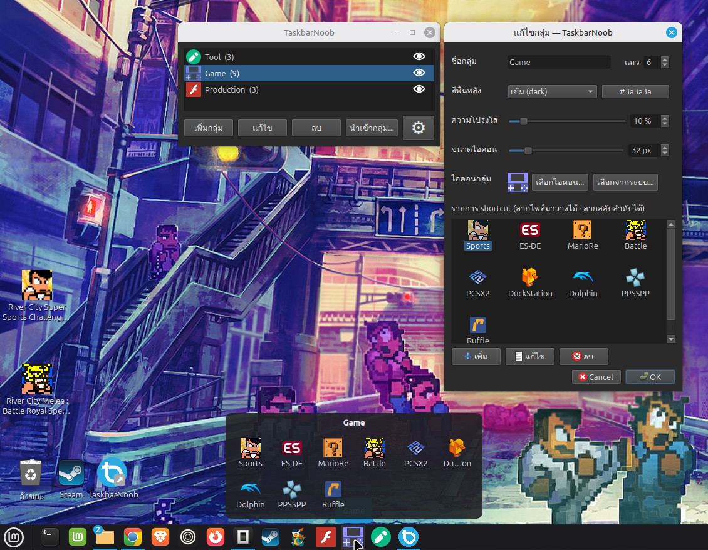
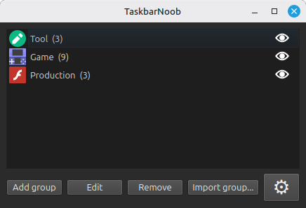
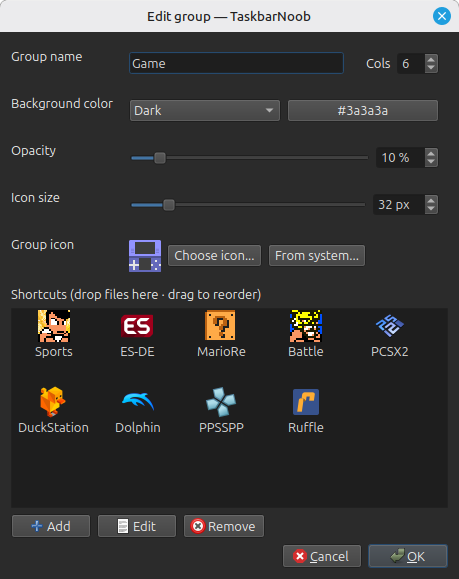

# TaskbarNoob

<p align="left">
  <a href="README.md">🌐 English</a> · <strong>🇹🇭 ภาษาไทย</strong>
</p>

[](https://github.com/Neafong/TaskbarNoob/releases/latest)
[](https://github.com/Neafong/TaskbarNoob/releases)
[](LICENSE)
[-green.svg?style=flat-square)](#)
[-blue.svg?style=flat-square)](#)
[](#)
[](https://github.com/Neafong/TaskbarNoob/actions)

> **รวบรวมทางลัด เรื่อง shortcut เราช่วยจัด** · *Gather your shortcuts, we do the rest.*

จัดกลุ่ม shortcut ของคุณให้เป็นระเบียบ แล้วกดครั้งเดียวเปิดทั้งกลุ่มได้เลย
รองรับ **Linux Mint (Cinnamon)** และ **Windows 11 (Portable)** · แจกฟรี เปิดซอร์ส

ชื่อ "Noob" ของเราไม่ได้หมายถึงแย่ — แต่หมายถึง **น้ำไม่เต็มแก้ว** ถ่อมตน ไม่มีอีโก้
เรียนรู้และเก่งขึ้นได้เรื่อย ๆ · แจกฟรี ทำด้วยใจ ❤️

---

## ตัวอย่างหน้าจอ

**ภาพรวมหน้าจอ**



| หน้าหลัก | แก้ไขกลุ่ม |
| :---: | :---: |
|  |  |

## ฟีเจอร์เด่น

- 🗂️ จัดกลุ่ม shortcut เป็นการ์ด แต่ละกลุ่มมี grid ของไอคอน (ลากจัดลำดับได้ + ตั้งแสดงชื่อใต้ไอคอนแยกต่อกลุ่มได้)
- 📱 เพิ่มแอปง่ายในคลิกเดียวด้วยปุ่ม **"จากแอป..."** (Linux `.desktop`/Flatpak/Snap และ Windows Start Menu/MSIX)
- 🖼️ ดึงไอคอนอัตโนมัติครบทั้ง **AppImage**, แอป Electron/Portable (`.asar`), **Steam** (`steam://rungameid/`), Flatpak/Snap และ Windows **MSIX** พร้อมตัวเลือกไอคอนระบบแบบแยกหมวด
- 📌 ปักหมุดกลุ่มลง **Cinnamon panel** (Flyout ตรึงตรงกึ่งกลางไอคอนจริงบน panel) และสร้าง `.lnk` แยก **AUMID** ต่อกลุ่มบน Windows 11
- ⌨️ ตั้ง **ปุ่มลัด (hotkey)** เปิดกลุ่มแบบ Focus Mode กลางจอ (ปรับขนาดไอคอนได้)
- 🎨 ธีม auto / light / dark · ปรับความโปร่งใสและขนาดไอคอน
- 💾 **Portable** — config อยู่ในโฟลเดอร์แอป (`config/`) ย้ายเครื่องได้ทันที
- 🌐 **9 ภาษาในตัว** (ไทย · English · 日本語 · 简体中文 · 한국어 · Español · Deutsch · Français · Português) + ส่งออก/นำเข้า JSON เพิ่มภาษาเองได้
- 📦 สำรอง/กู้คืน config ทั้งชุดเป็นไฟล์ `.zip`

> ฟีเจอร์ปักหมุดอัตโนมัติและ global hotkey บน Linux รองรับ **Cinnamon** เป็นหลัก

## แพลตฟอร์มที่รองรับ

| ระบบ | สถานะ |
| :--- | :--- |
| **Linux Mint (Cinnamon)** | ✅ รองรับหลัก — AppImage & `.deb` |
| **Windows 11** | ✅ Portable (`TaskbarNoob.exe`) — COM `.lnk` + AUMID แยกต่อกลุ่ม + Win32 Hotkey |
| **macOS** | ⚪ ยังไม่รองรับในรุ่นปัจจุบัน (ทีมไม่มีเครื่อง Mac สำหรับทดสอบ) |

## ดาวน์โหลด & ติดตั้ง

[](https://github.com/Neafong/TaskbarNoob/releases/latest)

เลือกจากหน้า **Releases** ของ repo:

**Linux — AppImage** (ไม่ต้องติดตั้ง)
```bash
chmod +x TaskbarNoob-x86_64.AppImage
./TaskbarNoob-x86_64.AppImage
```

**Linux — `.deb`** (Debian/Ubuntu/Mint)
```bash
sudo apt install ./taskbarnoob_<version>_amd64.deb
```

**Windows 11 — Portable `.zip`**
- แตกไฟล์แล้วรัน `TaskbarNoob.exe` ได้ทันที (เก็บ config แบบ portable ในโฟลเดอร์ `config/` ข้างตัวแอป)
- กดปุ่มโฟลเดอร์ที่กลุ่มเพื่อเปิด `config/shortcuts/` แล้วลากไฟล์ `.lnk` ไปปักบน Taskbar ได้เลย

## รันจากซอร์ส

```bash
python3 -m venv .venv
.venv/bin/pip install -r requirements.txt
.venv/bin/python -m taskbarnoob
```

CLI:
```bash
.venv/bin/python -m taskbarnoob --list              # แสดงรายชื่อกลุ่ม
.venv/bin/python -m taskbarnoob --open "<GroupDir>" # เปิด flyout ของกลุ่ม
```

## Build แพ็กเกจ

```bash
# Linux
bash packaging/build_appimage.sh   # -> dist/TaskbarNoob-x86_64.AppImage
bash packaging/build_deb.sh        # -> dist/taskbarnoob_<ver>_amd64.deb

# Windows (PowerShell)
powershell -ExecutionPolicy Bypass -File packaging/build_windows.ps1
```

## ทดสอบ

```bash
.venv/bin/python tests/run.py      # 392 tests
```

## ภาษา & การเพิ่มภาษาใหม่

ตัวแอปมาพร้อม **9 ภาษาในตัว** เลือกเปลี่ยนได้ทันทีจาก **Settings**:
ไทย · English · 日本語 · 简体中文 · 한국어 · Español · Deutsch · Français · Português (Brasil)

อยากเพิ่มภาษาอื่นเองก็ทำได้ง่าย ๆ:
1. Settings → **ส่งออกภาษา** เพื่อได้ไฟล์ JSON ต้นแบบ (หรือดูตัวอย่างใน [`packaging/lang/`](packaging/lang/))
2. แปลค่า (value) เป็นภาษาของคุณ
3. Settings → **นำเข้าภาษา** เลือกไฟล์ที่แปล → เลือกใช้จากช่องภาษาได้เลย

## โครงสร้างโปรเจกต์ (ย่อ)

```
taskbarnoob/
├── core/
│   ├── platform/   backend แยกตาม OS (linux/ · win32/)
│   ├── icons/      pipeline ดึง/แคชไอคอน (theme · appimage · portable · steam)
│   ├── i18n/       ระบบภาษา (TH/EN + bundled JSON + user overlay)
│   └── ...         models · storage · paths · launcher · settings · archive
└── gui/            ส่วน Qt/PySide6 (main_window · group_editor · app_picker · flyout …)
packaging/          build scripts · assets (โลโก้) · lang (7 ภาษาแพ็กติดแอป) · appimage/
tests/              unittest ชุดทดสอบ (392 tests)
docs/               เอกสารออกแบบ + worklog + roadmap
```

## เครดิต & สนับสนุน

สร้างโดย **Noob & Jenny** — ไอเดีย/ดีไซน์: นู๊บ · โค้ด: เจนนี่

ถ้าชอบและอยากสนับสนุน ☕ → [ko-fi.com/neafong](https://ko-fi.com/neafong)

## Roadmap

- [x] **Linux Mint (Cinnamon)** — จัดกลุ่ม shortcut · ปักหมุด panel · Flyout ตรึงตำแหน่ง · hotkey · Auto-Migration จาก `taskbargroups`
- [x] **Windows 11** — portable `.exe` · COM `.lnk` + AUMID · Win32 Hotkey · ปุ่ม "จากแอป..." (Start Menu & MSIX)
- [x] **9 ภาษาในตัว** + ส่งออก/นำเข้าภาษา + สำรอง/กู้คืน config `.zip`
- [ ] ฟีเจอร์เพิ่มเติมตามฟีดแบ็กผู้ใช้ (Wayland / multi-monitor / DE อื่น ๆ)

## สัญญาอนุญาต (License)

**GNU General Public License v3.0 or later (GPL-3.0-or-later)**

Copyright (C) 2026 Noob & Jenny

โปรแกรมนี้เป็นซอฟต์แวร์เสรี — คุณใช้/ศึกษา/แก้ไข/แจกจ่ายได้ ภายใต้เงื่อนไข GPL
โดยเฉพาะ **ถ้านำไปแจกจ่ายหรือต่อยอด ต้องเปิดซอร์สโค้ดให้ผู้อื่นด้วยในเงื่อนไขเดียวกัน**
ดูข้อความสัญญาฉบับเต็มที่ไฟล์ [LICENSE](LICENSE) · `SPDX-License-Identifier: GPL-3.0-or-later`

<sub>หมายเหตุ: ไลบรารี Qt/PySide6 ที่ใช้เป็นลิขสิทธิ์แยกต่างหาก (LGPLv3) — ไม่ได้อยู่ภายใต้ GPL ของโปรเจกต์นี้</sub>

---

<sub>รุ่น v0.3.0 รีแบรนด์ชื่อภายในทั้งหมดเป็น `taskbarnoob` พร้อมระบบ Auto-Migration ย้ายการปักหมุดและฮอตคีย์เดิมจาก `taskbargroups` ให้อัตโนมัติ</sub>
